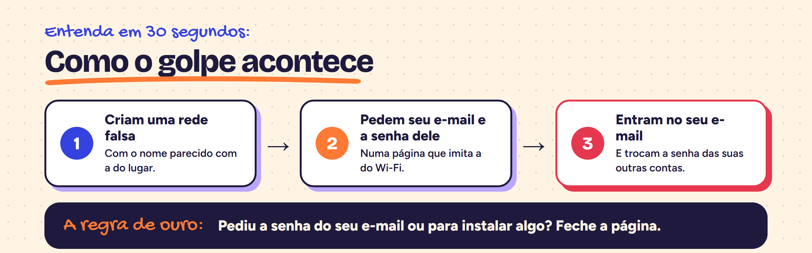
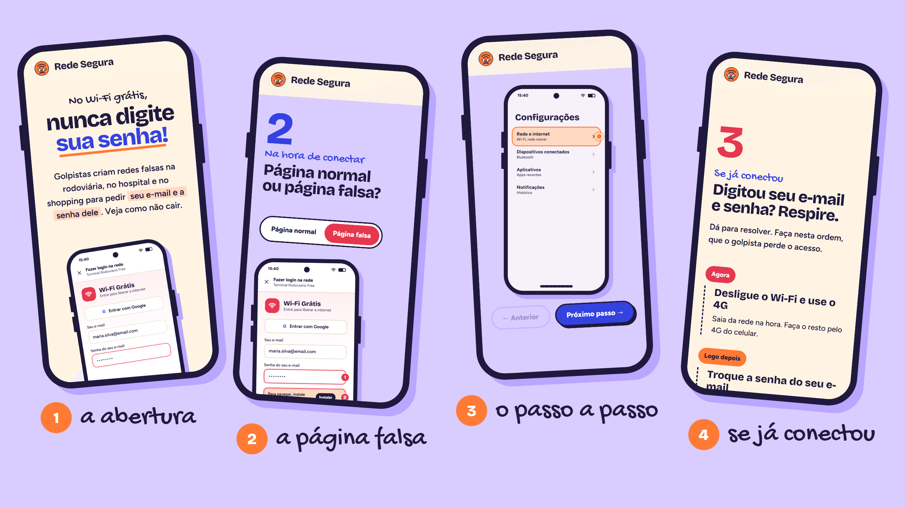

<p align="center">
  
</p>

<p align="center">
  Um <b>site</b> e um <b>panfleto</b> para ensinar pessoas mais velhas e suas famílias<br>
  a não cair no golpe do Wi-Fi falso.
</p>

<p align="center">
  
  
  
  
  
</p>

## O golpe



## O site

Feito para ser aberto no celular, depois de receber o panfleto. Tudo em português simples, sem termo técnico, dividido em três momentos: antes de conectar, na hora de conectar e se já conectou.



- **Antes de conectar:** o golpe em 30 segundos e uma lista rápida para conferir antes de tocar na rede.
- **Página normal ou falsa?** As duas telas de login do Wi-Fi lado a lado, com anotações do que é normal e do que é golpe.
- **Não deixe o celular conectar sozinho:** o passo a passo para apagar as redes abertas salvas no Android e no iPhone, com as telas do celular.
- **Se já conectou:** o que fazer na hora, em ordem, para o golpista perder o acesso.
- **Família:** uma mensagem pronta para mandar no grupo, com botão de copiar e de compartilhar.

## Pensado para quem tem mais idade

- **A+** aumenta o texto do site inteiro, e **Ouvir** lê em voz alta a parte que está na tela.
- Botões grandes, contraste alto e foco visível para quem usa o teclado.
- Nenhum dado é coletado: sem cadastro, sem formulário, sem rastreamento.

## Rodando o projeto

```bash
npm install
npm run dev     # abre o site no endereço que aparecer no terminal
npm run build   # gera a versão final em dist/
```

<details>
<summary><b>Estrutura das pastas</b></summary>

```
src/
├── components/   cabeçalho, rodapé, mascote, celular, página do Wi-Fi e ícones
├── sections/     uma parte da página por arquivo (abertura, os três momentos, família...)
├── hooks/        A+, leitura em voz alta, seção ativa, copiar e compartilhar
├── lib/          leitura em voz alta
├── styles/       cores e estilos, tirados do panfleto
└── types/        tipos compartilhados

public/panfleto/  frente e verso do panfleto
docs/             imagens deste README
```

</details>

## Quem fez

**[Mauro Junior](https://github.com/mj01px)**, **[Pablo de Souza](https://github.com/1pablex)**, **Matheus Henrique** e **Victor Teixeira**<br>
Engenharia de Software, 8B Noturno · Universidade de Mogi das Cruzes · 2026
