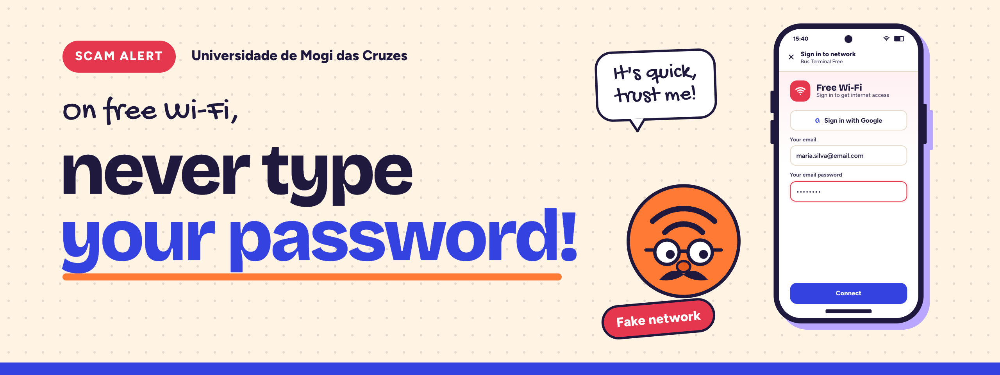
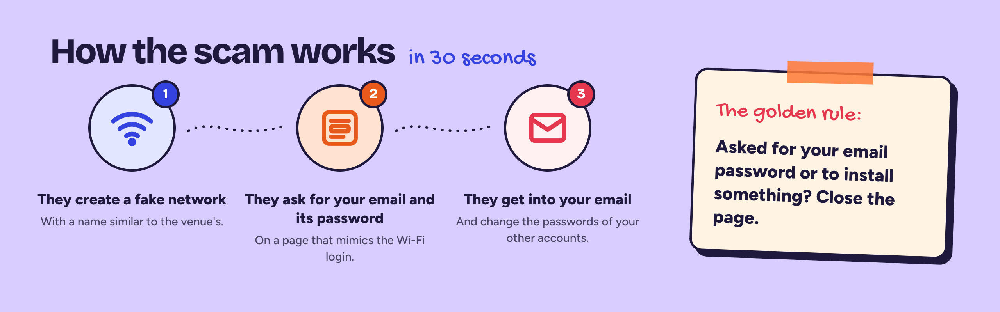
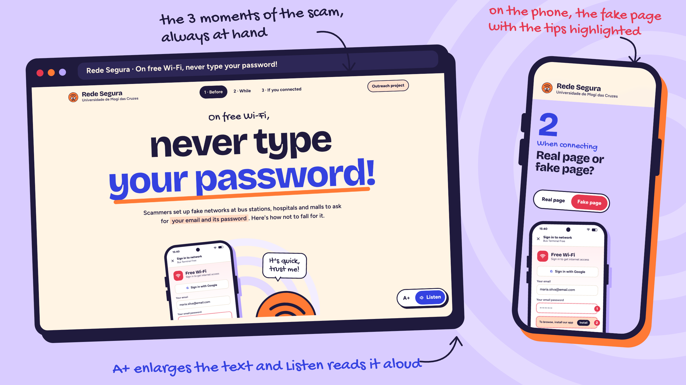

<p align="center">
  
</p>

<p align="center">
  A <b>website</b> and a <b>flyer</b> that teach older adults and their families<br>
  not to fall for the fake Wi-Fi scam.
</p>

<p align="center">
  
  
  
  
  
</p>

## The scam



## The website

Designed to be opened on a phone after receiving the flyer. Everything is written in plain language, with no technical jargon, split into three moments: before connecting, while connecting, and if you already connected.



- **Before connecting:** the scam in 30 seconds and a quick checklist to go through before tapping the network.
- **Real or fake page?** Both Wi-Fi login screens side by side, annotated with what is normal and what is a scam.
- **Don't let your phone connect on its own:** a step-by-step guide to removing saved open networks on Android and iPhone, with screenshots of the phone.
- **If you already connected:** what to do right away, in order, so the scammer loses access.
- **Family:** a ready-made message to send to the family group chat, with copy and share buttons.

## Built for older users

- **A+** enlarges the text across the whole site, and **Listen** reads the visible section aloud.
- Large buttons, high contrast, and a visible focus indicator for keyboard users.
- No data is collected: no sign-up, no forms, no tracking.

## Running the project

```bash
npm install
npm run dev     # opens the site at the address shown in the terminal
npm run build   # builds the production version into dist/
```

<details>
<summary><b>Folder structure</b></summary>

```
src/
├── components/   header, footer, mascot, phone, Wi-Fi page, and icons
├── sections/     one page section per file (opening, the three moments, family...)
├── hooks/        A+, read-aloud, active section, copy and share
├── lib/          read-aloud
├── styles/       colors and styles, taken from the flyer
└── types/        shared types

public/panfleto/  front and back of the flyer
docs/             images for this README
```

</details>

## Authors

**[Mauro Junior](https://github.com/mj01px)**, **[Pablo de Souza](https://github.com/1pablex)**, and **[Matheus Henrique](https://github.com/Zipl1n)**<br>
Software Engineering, 8B Evening · Universidade de Mogi das Cruzes · 2026
